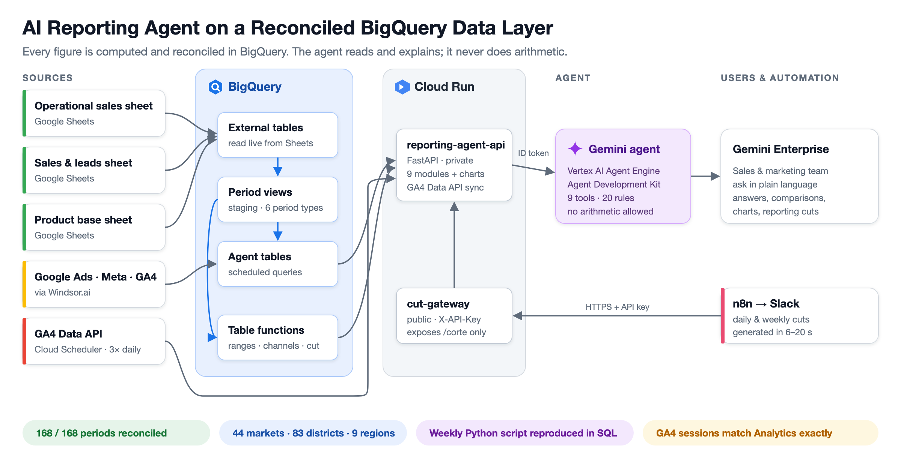
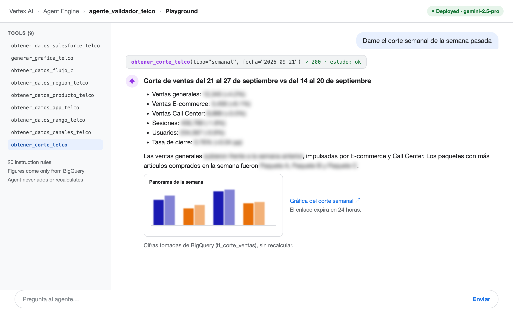
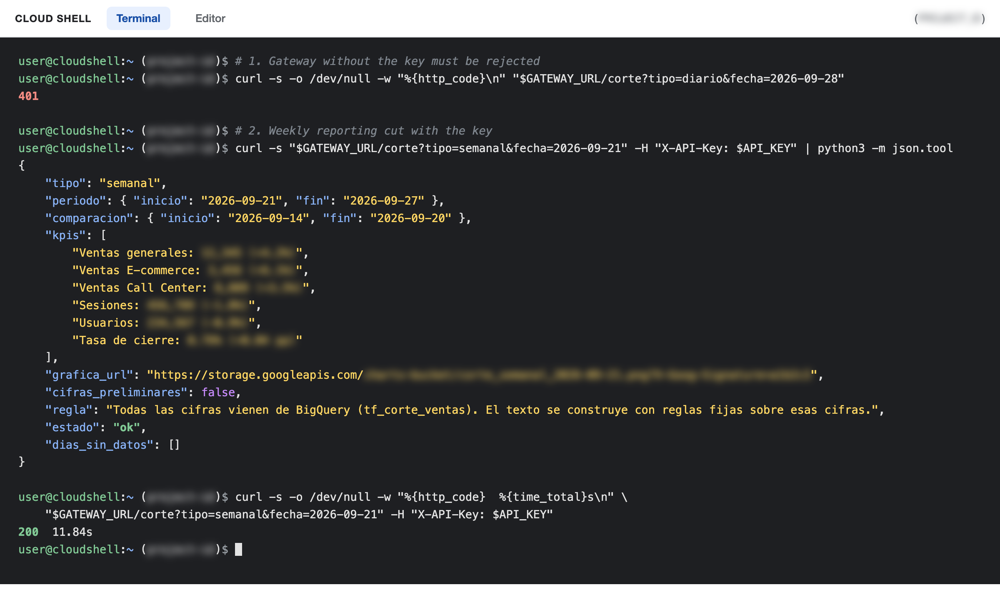

# AI Reporting Agent on a Reconciled BigQuery Data Layer

A Gemini agent that answers sales, installation, digital and reporting questions for a national internet and TV provider, without ever calculating a number itself. Every figure, period and comparison is resolved in a BigQuery data layer and reconciled against the client's audited reports before the agent reads it.

Built for a marketing agency's AI division, on Google Cloud. Client names, identifiers and financial figures are removed. Operational and validation figures are real.

## Impact at a glance

| Figure | What it means |
|---|---|
| 168 of 168 | Periods where the audited national total matches the sum of 44 markets |
| 8 of 10 | Figures from published weekly reports matched exactly; the other two differed by 1 and 3 sales (0.06% at most) |
| 44, 83, 9 | Plazas, districts and commercial regions, served at three levels that are never added together |
| 6 period types | Day, week, half month, month, month to date, previous month to the same cutoff, plus any custom range |
| 9 tools, 20 rules | Agent tools for every module, with written rules that forbid the agent from doing arithmetic |
| 6 to 20 seconds | Time to produce a daily or weekly reporting cut with chart and analysis text, previously built by hand |
| Exact | GA4 sessions and active users now match the Analytics screen; the earlier export ran 1 to 2% above it |
| 8 of 8 | Figures of the team's weekly Python script reproduced exactly in SQL, the basis for retiring a manual process |
| 0 | Client objects edited or deleted; everything was built alongside the existing layer |

## What it does

- **Sales and installations (Flow A):** reads a human-formatted Google Sheet (no Salesforce API available), reads each column's date from the header row, and serves national, plaza, district and regional figures for every period type.
- **Digital layer (Flow C):** media, acquisition, behaviour, channel groups, products and apps from Google Ads, Meta and GA4, each keeping its own meaning.
- **Reporting cut:** the daily and weekly sales update the team used to assemble by hand, now generated with reconciled figures, a chart in the team's format and rule-based analysis text, available in the agent and through a key-protected endpoint for n8n.
- **GA4 Data API sync:** headline sessions, users and closing rate read directly from GA4 three times a day.

## In action

The agent producing the weekly reporting cut from BigQuery figures (values blurred):

The key-protected gateway for n8n: 401 without the key, the weekly cut and 200 with it (values blurred):

## Tech stack

BigQuery (external tables, views, table functions, scheduled queries), Cloud Run (FastAPI, Python, matplotlib), Cloud Scheduler, Vertex AI Agent Engine, Agent Development Kit, Gemini Enterprise, GA4 Data API, Windsor.ai, Google Apps Script, n8n.

## Repository map

| Path | Contents |
|---|---|
| [docs/CASE_STUDY.md](docs/CASE_STUDY.md) | The story: challenge, approach, results, lessons |
| [docs/TECHNICAL.md](docs/TECHNICAL.md) | Architecture, data model, modules, rules, schedules, security, risks |
| [docs/DELIVERY_REPORT.md](docs/DELIVERY_REPORT.md) | Timeline, deliverables, validation log, problems solved, open items |
| [docs/HANDOVER.md](docs/HANDOVER.md) | Redeploy steps, identity migration, how the pieces connect |
| [docs/IMAGES.md](docs/IMAGES.md) | Screenshot checklist: what to capture and where each image goes |
| [architecture/](architecture/) | Architecture diagram source (Mermaid) |
| [sql/agent_queries/](sql/agent_queries/) | The query each agent module runs |
| [sql/validation/](sql/validation/) | Reconciliation queries used to prove each module |
| [sql/research/](sql/research/) | Investigation queries (GA4 export, event tracking) |
| [sql/audit/](sql/audit/) | Data quality and freshness checks |
| [sql/order_layer/](sql/order_layer/) | Order level analysis (attach rate, add-ons per package) |
| [scripts/](scripts/) | Lineage audit, health check, API comparison and validation scripts |
| [services/](services/) | Cloud Run services and the agent deployment script |

## Principles

1. All metric logic lives in the data layer. The agent reads and explains; it never adds up.
2. Reconciliation is a deliverable. Every difference is recorded with metric, period, source, size, cause and decision.
3. Build alongside, never on top. New objects get new names; old definitions are kept as a rollback reference.
4. Sources are read only. Errors are reported to the owner, not patched.
5. Incomplete data is stopped before it is published.

## Portfolio

Full write-up with images: [Portfolio link](https://www.datascienceportfol.io/Ahadmoeen)
