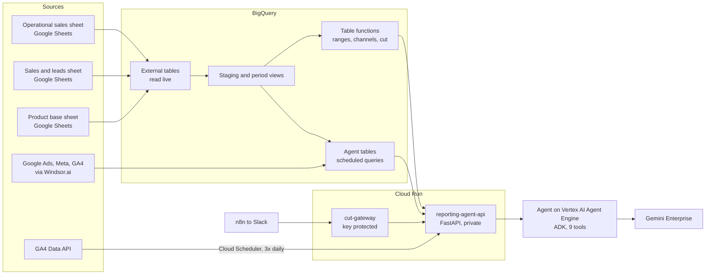

# Technical documentation

Object, service and tool names are anonymized. `PROJECT_ID` and `DATASET` stand for the Google Cloud project and the BigQuery dataset.

## 1. Architecture

Five sources land in BigQuery, where every period, comparison and reconciliation is resolved. One Cloud Run service reads that layer for both the agent and the n8n endpoint, so the agent and Slack always show the same figures.

| Component | Role | Built with |
|---|---|---|
| Sheet connections | Read the operational, sales and leads, and product sheets live, with no manual copies | BigQuery external tables |
| Windsor tasks | Bring Google Ads, Meta and GA4 into BigQuery daily | Windsor.ai |
| GA4 sync | Sessions, active users and closing rate exactly as the Analytics screen shows them | Cloud Run route triggered by Cloud Scheduler |
| Staging and period views | Turn the sheet layout into rows, read dates from the header row, build every period | BigQuery views |
| Agent tables | Hold finished figures, rebuilt after the sources load | BigQuery tables, scheduled queries |
| Table functions | Custom ranges, channel groups and the reporting cut for any dates | BigQuery table functions |
| reporting-agent-api | Selects rows, formats answers, draws charts, assembles the cut | Cloud Run, FastAPI, matplotlib |
| Agent | Understands the question, calls the right tool, writes the answer | Vertex AI Agent Engine, ADK, Gemini |
| cut-gateway | Gives n8n the reporting cut and nothing else | Cloud Run, FastAPI |

### Why the core figures live in tables
Gemini Enterprise imports base tables but not views, and materialized views do not allow the joins this model needs. The core figures are therefore written to real tables by scheduled queries after the sources load, which keeps them usable by any engine.

### Why national and market figures are kept apart
The audited national figure is the sheet's Total row, which is not guaranteed to equal the sum of districts every day. If both lived in one table, an agent could add a national row to the rows it is summarizing. Separate tables rule out double counting by design.

## 2. Flow A: sales and installations

### Reading the sheet
- Four monthly tabs (sales and installations, each for call center and e-commerce) read through external tables, each declared with 702 text columns. BigQuery fixes an external table's width on creation; the originals stopped at 106 to 118 columns, so new months would have fallen outside them.
- Each column's date comes from the header row, not its position. A new month is picked up with no SQL change.
- New objects read the sheet live and hold no copy, so reprocessing cannot create duplicates.
- Numbers typed with thousands separators are parsed explicitly instead of becoming zero.
- The correction applied to the full history, with the old definitions saved as a rollback reference.

### Plaza to district map
The sheet shows each plaza name only on the first row of its group, and BigQuery does not keep row order. An Apps Script attached to the sheet writes the plaza of every district to `dim_plaza_distrito` each morning. It refuses to save if it reads fewer than 50 districts, so a bad read fails loudly instead of shrinking the map. Result: 83 districts in 44 plazas, none orphaned or duplicated.

### National figure and reconciliation
- National figures come from the Total row and are never calculated.
- The sum of the 44 plazas is kept as a check; every period carries a `cuadra` flag.
- First run: 167 of 168 periods. The exception was one cell typed as 236,000 where the plazas summed to 236. It was reported to the owner, not patched. After the fix: 168 of 168.

### Market levels
Three levels, never added together: 44 plazas, 83 districts and 9 commercial regions. Regions are built only from plaza rows. A district recorded under another plaza reports inside it until the source changes.

### Periods
| grano | Covers |
|---|---|
| diario | One day |
| semanal | Monday to Sunday |
| quincenal | Day 1 to 15, and 16 to month end |
| mensual | Full calendar month |
| mes_a_la_fecha | Day 1 to the latest loaded day |
| mes_anterior_mismo_corte | Previous month, day 1 to the same day number |

- Weeks crossing month boundaries are assigned by their days, so monthly totals never contradict the sum of their days.
- Month to date is kept separate because the newest month is always incomplete.
- `periodo_completo` is FALSE while a period is open; the agent warns before giving such a figure.
- Custom ranges are summed inside BigQuery (`tf_rango_personalizado`), with the comparison range shifted by a chosen number of days. A full week computed this way matches the weekly row exactly.

### Charts
Four chart types reproduce slides of the weekly deck in its colors (month to date by subchannel, daily sales, weekly overview, plaza table). They are rendered with matplotlib in Cloud Run and shared as signed links valid for 24 hours.

## 3. Flow C: digital layer

### Ingestion fixes
- Windsor field names confirmed by testing: the session key event rate is `session_conversion_rate`, lead columns are `conversions_<event>`, and Ads reach is `unique_users`.
- Ads reach backfilled for 90 days into its own table; it is never added across days or campaigns.
- Two Windsor tasks that only duplicated production tables were paused; a sessions table split by event name, which inflated sessions, was corrected.
- 61 duplicate rows found and removed after a backup (139,510 to 139,449 rows, date range unchanged).
- Campaign classification moved to a mapping tab the agency owns. The join ignores case and extra spaces. Two quality checks: spend without mapping, and mapping rows that match no campaign.

### Layers
| Layer | Answers | Source |
|---|---|---|
| media | Spend, impressions, clicks, views, conversions, CPA, VTR by channel and campaign | Google Ads and Meta via Windsor |
| acquisition | Sessions, users, purchases, revenue, average ticket, with one official total row per period | GA4 via Windsor |
| behaviour | Events by funnel stage and key events | GA4 via Windsor |
| channel groups | Sessions and purchases by GA4 default channel group, with source and medium | GA4 via Windsor |
| products | Items by family (2P, 3P, Addon), article and package | Product base sheet |
| apps | Items whose package includes each app, with an overlap warning | Product base sheet |
| event campaign | Sessions, leads and campaigns of a one-off event | Separate GA4 property via Windsor |

### Rules for combined answers
- A GA4 purchase is an online service request, not a sale. The agent never divides GA4 purchases by sales.
- GA4 uses data driven attribution with a 30 day lookback.
- In integrated answers, sales come first, digital second, then an "observed relationship" section that describes what moved together without claiming cause.

### Counts that are not the same metric
| Name | Counts |
|---|---|
| Sales | Sales recorded in the CRM sheet |
| Digital purchases | GA4 purchase events, one per order |
| Orders | Distinct order IDs in the product base |
| Items purchased | Items, one order with three items is 3 |

Week 37 example: 4,904 sales, 2,628 digital purchases, 2,612 orders, 3,687 items.

## 4. Reporting cut

`tf_corte_ventas(p_inicio, p_fin)` returns every figure of the cut already compared: `nivel = 'dia'` per day and `nivel = 'rango'` for the range.

| Part | Source |
|---|---|
| Total, e-commerce and call center sales | Operational sheet (reference for totals) |
| Call center subchannels and leads | Sales and leads sheet, copied hourly to `ventas_leads_diario` |
| Sessions, active users, closing rate | GA4 Data API (`vw_ga4_corte`), export as backup |
| Top packages | Product base sheet |

### Rules
- The operational sheet is the reference for totals; differences with the sales and leads sheet are always shown in the notes.
- The subchannel explanation is shown only when the subchannel sum is within 1% of the call center total in the sales and leads sheet, and the difference between sheets is within 1% of the operational call center total, in both the reported and comparison periods. Otherwise only that explanation is left out.
- If the operational sheet is not loaded for a day, the sales and leads sheet is used and the cut is marked preliminary in text and chart.
- If any day has no sales data, `estado = incompleto` with `dias_sin_datos` and `dias_sin_datos_comparacion`. Publish only when `estado = ok`.

### Speed
The first weekly cut timed out at 61 seconds because each request read the live sheet about five times. The sales and leads sheet is now copied to BigQuery hourly and the service timeout is 300 seconds. Daily cut: 6 to 10 seconds. Weekly cut: 10 to 20 seconds.

### Response contract (cut-gateway)
`GET /corte?tipo=diario|semanal&fecha=YYYY-MM-DD` with header `X-API-Key`.

| Field | Meaning |
|---|---|
| texto | Text ready to publish, notes included |
| grafica_url | PNG chart, downloadable without the key for 24 hours |
| notas | Notes as a list, for reference only |
| cifras_preliminares | TRUE when the operational sheet was not loaded |
| periodo, comparacion | Reported and comparison dates |
| estado | `ok`, or `incompleto` with the missing days |

Errors: 401 missing or wrong key, 400 invalid type or incomplete date, 404 no data, 500 or 502 source failure.

## 5. GA4 Data API sync

- The service account has Viewer on the GA4 property.
- A route on the main service requests `sessions`, `activeUsers` and `sessionKeyEventRate:purchase`, daily and per Monday to Sunday week, so weekly users are unique users, not a sum of days.
- Cloud Scheduler runs it at 10:00, 16:00 and 21:00 UTC, refreshing the last 120 days.
- `vw_ga4_corte` prefers the API row and falls back to the GA4 BigQuery export for any missing period, with a source column.
- Setup notes: enabling the API from Cloud Shell failed on a quota billed to another project, and impersonating the service account was denied, so the test ran inside Cloud Run, which already runs as the service account.

Validation: one week returned 563,343 sessions and 381,647 active users, the same as the Analytics screen.

## 6. Agent

- Vertex AI Agent Engine, built with the Agent Development Kit, deployed from one script that holds the 9 tools and 20 rules.
- Published in Gemini Enterprise as a custom agent pointing to the engine.

| Tool | Answers | Route |
|---|---|---|
| obtener_datos_salesforce | National, plaza and district sales and installations | /api/v1/salesforce |
| obtener_datos_region | Nine commercial regions | /api/v1/region |
| obtener_datos_rango | Custom ranges and their comparison | /api/v1/rango |
| generar_grafica | The four deck charts | /api/v1/chart |
| obtener_datos_flujo_c | Media, acquisition, behaviour, event campaign | /api/v1/flujo_c |
| obtener_datos_canales | Channel groups, source and medium | /api/v1/canales |
| obtener_datos_producto | Items by family, article and package | /api/v1/producto |
| obtener_datos_app | Apps included in packages | /api/v1/apps |
| obtener_corte | Daily and weekly reporting cut | /api/v1/corte |

### Rules, in short
- Always call a tool before giving a figure; never ask for dates it can work out.
- The official figure is the total row; never add up the breakdown.
- Warn before any figure that is not final or carries a warning.
- Never mix national and market figures; never add regions for a national figure.
- Copy period dates exactly from the tool response.
- Compare with the previous comparable period and close with a reading of at most three sentences, based only on the figures.
- Never compute a conversion rate between GA4 and sales.
- Report tool errors plainly; never fill gaps with estimates.

## 7. Security
- The main Cloud Run service is private. The agent calls it with an identity token as the project service account. Only the Agent Engine, Vertex AI and Gemini Enterprise service agents hold Cloud Run Invoker.
- The cut-gateway must be reachable by n8n, so it uses a key instead: read from an environment variable, checked with a constant time comparison on every request, and the gateway calls the private service on n8n's behalf. It exposes only the cut.
- Chart images are signed links that expire in 24 hours.
- Sheets are read only; nothing is written back.

## 8. Schedules
| Job | When (UTC) | What it does |
|---|---|---|
| Digital agent table | 13:00 and 20:00 | Rebuilds `agente_telco_flujo_c` |
| National and market tables | 14:00 and 21:00 | Rebuild the sales agent tables |
| Region table | 14:30 and 21:00 | Rebuilds `agente_telco_region` |
| GA4 export backup | 19:00 and 21:30 | Rebuilds the backup GA4 figures |
| Sales and leads copy | Hourly | Copies the sheet into BigQuery |
| GA4 Data API sync | 10:00, 16:00 and 21:00 | Last 120 days |
| Plaza map (Apps Script) | 07:00 local | Updates the district to plaza map |

## 9. Data objects
| Object | Type | Purpose |
|---|---|---|
| stg_salesforce_v2 | View | Sheet rows by day and district, date from the header row |
| vw_periodos_v2, vw_periodos_distrito_v2, vw_periodos_plaza_v2 | Views | Every period type at national, district and plaza level |
| qc_nacional_vs_mercados_v2 | View | National total against the sum of plazas |
| dim_plaza_distrito | Table | District to plaza map, Apps Script |
| agente_telco_nacional | Table | National figures from the Total row, with check flags |
| agente_telco_mercado | Table | Plaza and district figures |
| agente_telco_region | Table | Nine regions built from plaza rows |
| agente_telco_flujo_c | Table | Digital layers |
| tf_rango_personalizado | Table function | Any date range with comparison |
| tf_canales_rango | Table function | Channel groups for any range |
| tf_corte_ventas | Table function | Daily and weekly reporting cut |
| vw_product_telco_v3 | View | Items by family, article and package |
| vw_app_frequency_telco | View | Apps in packages, with overlap warning |
| ventas_leads_diario | Table | Hourly copy of the sales and leads sheet |
| vw_corte_reconciliacion | View | Difference between the two sales sheets by day |
| ga4_api_telco | Table | Daily and weekly GA4 Data API figures |
| vw_ga4_corte | View | API first, export as fallback |

A lineage audit (`scripts/audit_dataset_lineage.sh`) checks every object against all views, table functions, scheduled queries and service code, and classifies it as used, supporting, quality check, prepared, unused, earlier version or unrelated.

## 10. Rules to preserve
- A total always comes from `fila_es_total = TRUE`; detail rows are for breakdowns.
- Plaza and district rows describe the same sales; never add them together.
- Standard periods are read from their own row; only custom ranges are summed, inside BigQuery.
- Users are never added across days or channel groups.
- App counts overlap and are never added together.
- Each GA4 view keeps its own label; a rate never mixes views.

## 11. Known risks found
| Risk | Impact |
|---|---|
| The product ID tab has no headers and is read by column position | A column inserted in the sheet silently mixes package and family |
| The order tab stores dates and quantities as text | A date filter on text silently dropped three weeks in testing |
| The event campaign layer has no total row | The agent would add 322 rows itself |
| A calculated CPM column is spend over clicks times 1,000 | Not a standard CPM |
| Accent variants of the same add-on name | Add-on counts split in two |
| The team's weekly script runs on one computer and picks the week by row order | Single point of failure and possible wrong comparison |
| Scheduled queries run with a user's credentials | They stop if that user loses access; migration steps in HANDOVER.md |
